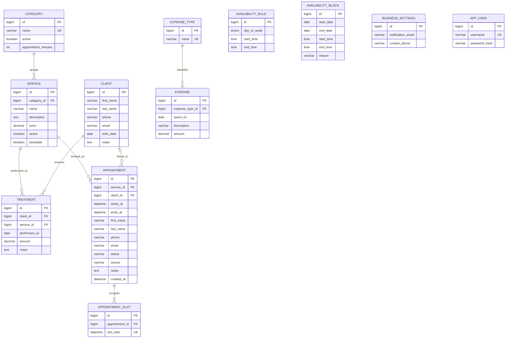

# Modelo de datos

Tablas y columnas en inglés (convención Spring/JPA). MySQL.

## Reglas
- `service.name` es único dentro de su categoría: `UNIQUE (category_id, name)`.
- `treatment.amount` se precarga con `service.price` y es editable (ADR 004).
- Categorías y servicios se desactivan con `active` cuando hay historial (ADR 005).
- Un cliente con tratamientos no se puede eliminar; la FK `treatment.client_id` lo garantiza a nivel base (sin cascada).
- La edad no se guarda: se calcula desde `client.birth_date`.
- `expense_type` es una lista fija cargada por migración; "Varios" siempre existe.
- `app_user` tiene un único registro precargado; no se relaciona con las demás tablas.
- Obligatorios: `client.first_name`, `client.last_name`; el resto de los datos del cliente es opcional. `service.description` es opcional.

### Turnos (ADR 013 y 014)
- `category.appointment_minutes`: 30 o 60 (60 por defecto). La migración pone 30 en "Depilación". Todos los servicios de la categoría heredan la duración.
- `service.bookable` (por defecto `true`): si el servicio se ofrece en la página pública. Además, el servicio y su categoría tienen que estar activos.
- `availability_rule`:
  - `day_of_week` va de 1 (lunes) a 7 (domingo), según ISO.
  - Puede haber varios rangos por día, sin superponerse.
  - `start_time` < `end_time`, ambos en múltiplos de 30 minutos.
- `availability_block`:
  - Bloquea de `start_date` a `end_date`, ambos incluidos (`start_date` <= `end_date`; un solo día tiene las dos iguales). Migración V5: reemplaza la `block_date` de la V4.
  - Sin `start_time`/`end_time` bloquea los días completos; con ellos, solo ese rango, y solo si es un bloqueo de un día. Las horas se cargan las dos o ninguna, en múltiplos de 30 minutos.
  - `reason` es opcional.
- `appointment`:
  - `starts_at` cae en :00 o :30; `ends_at` = `starts_at` + duración de la categoría al momento de reservar.
  - Nombre, apellido y teléfono son obligatorios. El teléfono se guarda normalizado (solo dígitos, de 8 a 15).
  - `status`: `CONFIRMED`, `CANCELLED`, `ATTENDED` o `NO_SHOW`.
  - `source`: `PUBLIC` o `ADMIN`.
  - `client_id` es opcional y se vuelve obligatorio para pasar a `ATTENDED`.
  - Índices por `starts_at` y por `phone`.
- `appointment_slot`:
  - Una fila por casillero de 30 minutos que ocupa un turno activo (`CONFIRMED` o `ATTENDED`).
  - `UNIQUE (slot_start)` impide la superposición a nivel base.
  - Al pasar a `CANCELLED` o `NO_SHOW` se borran sus filas; la FK `appointment_slot.appointment_id` usa `ON DELETE CASCADE`.
- Un cliente con turnos vinculados no se puede eliminar: la FK `appointment.client_id` no tiene cascada, igual que con los tratamientos.
- Un servicio con turnos no se puede eliminar, solo desactivar (ADR 005).

### Avisos por email (ADR 016)
- Migración V7.
- `client.email` y `appointment.email`: opcionales, `VARCHAR(254)`, guardados en minúsculas y sin espacios. Se usan solo para avisos del turno.
  - Al vincular un turno con email a un cliente sin email, se le copia. Uno ya cargado nunca se pisa.
- `business_settings`: una sola fila (`id = 1`), creada por la migración con los dos campos en `NULL`.
  - `notification_email`: dónde recibe la responsable los avisos de reservas públicas. Nunca se expone en la API pública.
  - `contact_phone`: celular para cancelar o reagendar, normalizado como el de los turnos (solo dígitos, de 8 a 15).
- Las credenciales SMTP no se guardan en la base: viven en el `.env` (`MAIL_*`).
